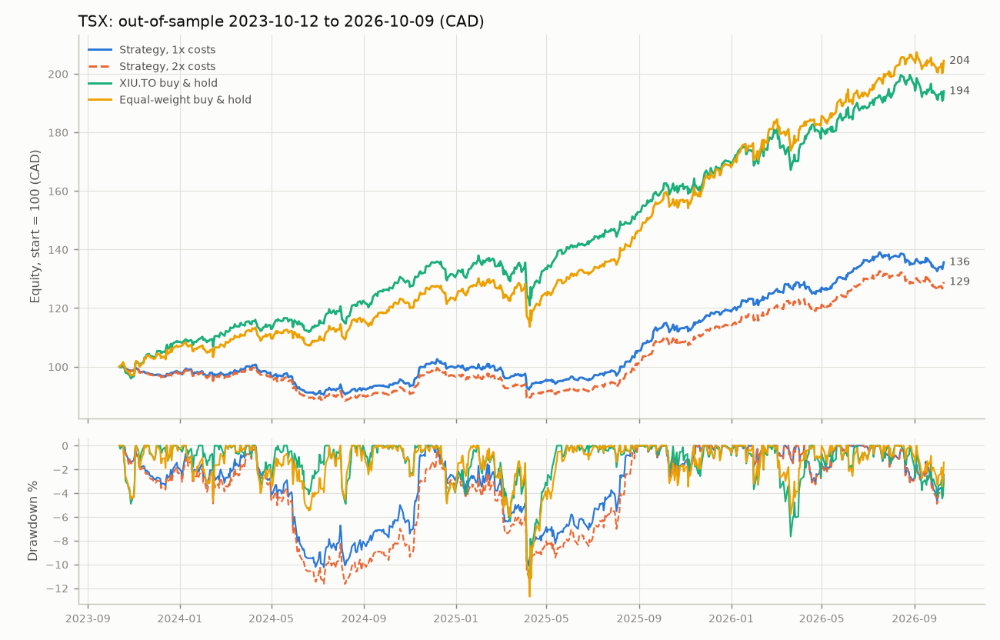
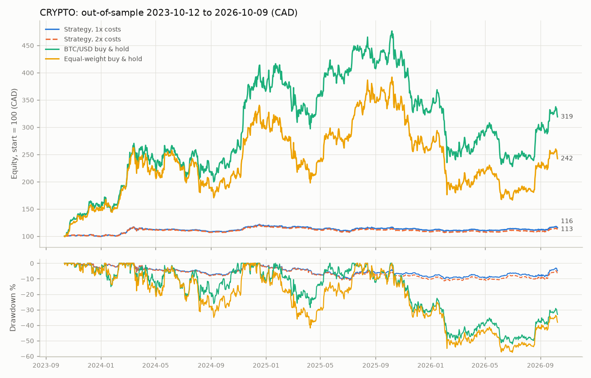
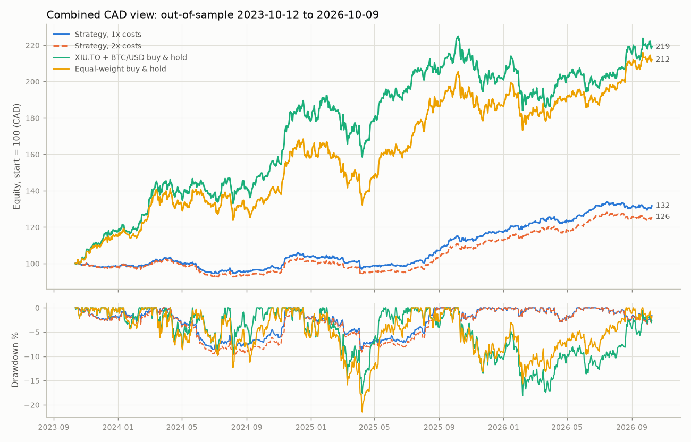

# Backtest: all, sentiment on

Period 2021-10-12 to 2026-10-09; out-of-sample (walk-forward) from 2023-10-12. Generated 2026-10-11 17:51 UTC.

## Headline (out-of-sample, 1x costs, vs buy-and-hold over the same window)

- tsx: strategy CAGR +10.7% (Sharpe 1.21, max drawdown -10.3%) vs XIU.TO buy & hold +24.8% (Sharpe 1.87, max drawdown -12.4%): the strategy UNDERperformed.
- tsx: strategy CAGR +10.7% (Sharpe 1.21, max drawdown -10.3%) vs Equal-weight buy & hold +27.0% (Sharpe 1.99, max drawdown -12.7%): the strategy UNDERperformed.
- crypto: strategy CAGR +5.0% (Sharpe 0.66, max drawdown -10.4%) vs BTC/USD buy & hold +47.3% (Sharpe 1.05, max drawdown -52.2%): the strategy UNDERperformed.
- crypto: strategy CAGR +5.0% (Sharpe 0.66, max drawdown -10.4%) vs Equal-weight buy & hold +34.4% (Sharpe 0.83, max drawdown -57.6%): the strategy UNDERperformed.
- combined: strategy CAGR +9.6% (Sharpe 1.32, max drawdown -8.7%) vs XIU.TO + BTC/USD buy & hold +30.0% (Sharpe 1.53, max drawdown -18.1%): the strategy UNDERperformed.
- combined: strategy CAGR +9.6% (Sharpe 1.32, max drawdown -8.7%) vs Equal-weight buy & hold (both) +28.5% (Sharpe 1.45, max drawdown -21.5%): the strategy UNDERperformed.

## Assumptions

- Decisions use bars closed at or before the decision time and news available strictly before it; orders fill at the next bar's open plus slippage, only if marketable against the limit (no intrabar fills).
- TSX decides 17:30 Toronto and fills next session's open; crypto decides 00:05 UTC and fills at the open of the UTC day that just began.
- FX: crypto trades in USD; every CAD figure converts USD at the Bank of Canada daily USD/CAD rate of the business day before each valuation (no lookahead). No currency-conversion costs are modelled.
- tsx: commission 0.01 CAD/share, min 1.0 CAD; slippage 10 bps per fill; fills capped at 5% of the bar's volume; limit offsets 100/300 bps (entry/exit). 2x runs double fees and slippage.
- crypto: Alpaca fee 25 bps (taker) per fill; slippage 15 bps per fill; fills capped at 5% of the bar's volume; limit offsets 25/100 bps (entry/exit). 2x runs double fees and slippage.
- Entries sized at 1% equity risk to a 3x ATR(14) stop, capped per symbol, by the regime/gross cap and by cash; positions are held until the trend exit or the stop (checked on closes).
- Survivorship: the universe is today's large caps, which flatters strategy and benchmarks alike.
- Regime macro-news term is 0 unless archived news covers the date.
- Dropped symbols: SOL/USD (usable history 2.12y < 3y minimum (since 2024-08-27))

## Walk-forward folds (parameters chosen in-sample only)

| asset_class | in_sample | out_of_sample | chosen_params | is_sharpe |
|---|---|---|---|---|
| tsx | 2021-10-12 to 2023-10-12 | 2023-10-12 to 2024-04-12 | fast=50, slow=100, momentum=126 | 0.26 |
| tsx | 2022-04-12 to 2024-04-12 | 2024-04-12 to 2024-10-12 | fast=20, slow=200, momentum=126 | -0.67 |
| tsx | 2022-10-12 to 2024-10-12 | 2024-10-12 to 2025-04-12 | fast=50, slow=100, momentum=126 | -0.24 |
| tsx | 2023-04-12 to 2025-04-12 | 2025-04-12 to 2025-10-12 | fast=50, slow=100, momentum=126 | 0.01 |
| tsx | 2023-10-12 to 2025-10-12 | 2025-10-12 to 2026-04-12 | fast=50, slow=200, momentum=63 | 1.17 |
| tsx | 2024-04-12 to 2026-04-12 | 2026-04-12 to 2026-10-09 | fast=50, slow=200, momentum=63 | 1.82 |
| crypto | 2021-10-12 to 2023-10-12 | 2023-10-12 to 2024-04-12 | fast=50, slow=200, momentum=126 | -0.21 |
| crypto | 2022-04-12 to 2024-04-12 | 2024-04-12 to 2024-10-12 | fast=50, slow=200, momentum=126 | 0.94 |
| crypto | 2022-10-12 to 2024-10-12 | 2024-10-12 to 2025-04-12 | fast=50, slow=200, momentum=126 | 0.62 |
| crypto | 2023-04-12 to 2025-04-12 | 2025-04-12 to 2025-10-12 | fast=20, slow=100, momentum=63 | 0.58 |
| crypto | 2023-10-12 to 2025-10-12 | 2025-10-12 to 2026-04-12 | fast=50, slow=100, momentum=63 | 1.04 |
| crypto | 2024-04-12 to 2026-04-12 | 2026-04-12 to 2026-10-09 | fast=50, slow=100, momentum=63 | 0.55 |

## Sentiment (with vs without, covered dates only)

- tsx: sentiment not backtestable for this period (archive starts 2026-10-11; nothing is backfilled): 0 of 753 decision days and 0 of 18 symbols covered
- crypto: sentiment not backtestable for this period (no archived news; nothing is backfilled): 0 of 1094 decision days and 0 of 2 symbols covered

## Results (CAD; per asset class and combined)

Rows starting with OOS are the honest out-of-sample results. 'Full period ... (in-sample)' rows use the default parameters on the whole period and are shown for reference only.

### tsx

| variant | total_return | cagr | ann_vol | sharpe | sortino | max_drawdown | calmar | win_rate | profit_factor | avg_holding_days | turnover | avg_exposure | trades | cost_drag |
|---|---|---|---|---|---|---|---|---|---|---|---|---|---|---|
| OOS 1x costs | +35.6% | +10.7% | 8.7% | 1.21 | 1.69 | -10.3% | 1.05 | 32.8% | 1.80 | 33.96 | 13.31 | 64.4% | 238 | 1.6% |
| OOS 2x costs | +28.9% | +8.9% | 8.7% | 1.02 | 1.40 | -11.6% | 0.76 | 30.7% | 1.60 | 33.96 | 13.39 | 64.4% | 238 | 3.3% |
| Full period 1x costs, default params (in-sample) | +49.1% | +8.3% | 8.6% | 0.98 | 1.37 | -19.3% | 0.43 | 34.2% | 1.76 | 36.11 | 11.33 | 56.2% | 336 | 1.4% |
| Full period 2x costs, default params (in-sample) | +38.7% | +6.8% | 8.6% | 0.81 | 1.12 | -22.5% | 0.30 | 31.0% | 1.56 | 36.11 | 11.34 | 56.2% | 336 | 2.7% |
| OOS: XIU.TO buy & hold | +94.0% | +24.8% | 12.3% | 1.87 | 2.75 | -12.4% | 2.01 |  |  |  |  |  |  |  |
| OOS: Equal-weight buy & hold | +104.4% | +27.0% | 12.5% | 1.99 | 2.89 | -12.7% | 2.12 |  |  |  |  |  |  |  |
| Full period: XIU.TO buy & hold | +97.5% | +14.6% | 12.9% | 1.12 | 1.61 | -16.4% | 0.89 |  |  |  |  |  |  |  |
| Full period: Equal-weight buy & hold | +122.6% | +17.4% | 13.7% | 1.24 | 1.77 | -17.4% | 1.00 |  |  |  |  |  |  |  |

### crypto

| variant | total_return | cagr | ann_vol | sharpe | sortino | max_drawdown | calmar | win_rate | profit_factor | avg_holding_days | turnover | avg_exposure | trades | cost_drag |
|---|---|---|---|---|---|---|---|---|---|---|---|---|---|---|
| OOS 1x costs | +15.7% | +5.0% | 7.9% | 0.66 | 0.97 | -10.4% | 0.48 | 21.4% | 1.64 | 16.29 | 2.52 | 7.2% | 42 | 1.0% |
| OOS 2x costs | +12.6% | +4.0% | 7.9% | 0.54 | 0.80 | -11.5% | 0.35 | 21.4% | 1.38 | 16.29 | 2.52 | 7.3% | 42 | 1.9% |
| Full period 1x costs, default params (in-sample) | +26.7% | +4.9% | 7.5% | 0.67 | 1.00 | -10.6% | 0.46 | 21.6% | 1.80 | 19.43 | 1.76 | 5.6% | 51 | 0.7% |
| Full period 2x costs, default params (in-sample) | +22.7% | +4.2% | 7.5% | 0.58 | 0.87 | -11.2% | 0.37 | 19.6% | 1.46 | 19.43 | 1.76 | 5.6% | 51 | 1.3% |
| OOS: BTC/USD buy & hold | +218.9% | +47.3% | 47.4% | 1.05 | 1.62 | -52.2% | 0.91 |  |  |  |  |  |  |  |
| OOS: Equal-weight buy & hold | +142.3% | +34.4% | 51.7% | 0.83 | 1.25 | -57.6% | 0.60 |  |  |  |  |  |  |  |
| Full period: BTC/USD buy & hold | +62.3% | +10.2% | 51.6% | 0.45 | 0.65 | -74.9% | 0.14 |  |  |  |  |  |  |  |
| Full period: Equal-weight buy & hold | +21.0% | +3.9% | 56.5% | 0.35 | 0.50 | -75.1% | 0.05 |  |  |  |  |  |  |  |

### combined

| variant | total_return | cagr | ann_vol | sharpe | sortino | max_drawdown | calmar | win_rate | profit_factor | avg_holding_days | turnover | avg_exposure | trades | cost_drag |
|---|---|---|---|---|---|---|---|---|---|---|---|---|---|---|
| OOS 1x costs | +31.6% | +9.6% | 7.1% | 1.32 | 1.87 | -8.7% | 1.11 | 31.1% | 1.79 | 31.31 | 11.09 | 52.6% | 280 | 1.5% |
| OOS 2x costs | +25.6% | +7.9% | 7.1% | 1.10 | 1.55 | -9.7% | 0.82 | 29.3% | 1.58 | 31.31 | 11.12 | 52.4% | 280 | 3.0% |
| Full period 1x costs, default params (in-sample) | +44.6% | +7.7% | 7.0% | 1.08 | 1.54 | -13.6% | 0.56 | 32.6% | 1.76 | 33.91 | 9.40 | 45.7% | 387 | 1.2% |
| Full period 2x costs, default params (in-sample) | +35.5% | +6.3% | 7.0% | 0.90 | 1.27 | -15.8% | 0.40 | 29.5% | 1.55 | 33.91 | 9.37 | 45.5% | 387 | 2.5% |
| OOS: XIU.TO + BTC/USD buy & hold | +119.1% | +30.0% | 18.2% | 1.53 | 2.30 | -18.1% | 1.65 |  |  |  |  |  |  |  |
| OOS: Equal-weight buy & hold (both) | +112.0% | +28.5% | 18.4% | 1.45 | 2.15 | -21.5% | 1.33 |  |  |  |  |  |  |  |
| Full period: XIU.TO + BTC/USD buy & hold | +90.5% | +13.8% | 14.2% | 0.98 | 1.41 | -25.0% | 0.55 |  |  |  |  |  |  |  |
| Full period: Equal-weight buy & hold (both) | +102.3% | +15.2% | 14.6% | 1.04 | 1.47 | -23.3% | 0.65 |  |  |  |  |  |  |  |

## Orders

- OOS 1x costs, tsx: 511 filled, 0 partial, 25 expired unfilled, 0 rejected by risk checks
- OOS 1x costs, crypto: 81 filled, 12 partial, 0 expired unfilled, 0 rejected by risk checks
- OOS 2x costs, tsx: 511 filled, 0 partial, 25 expired unfilled, 0 rejected by risk checks
- OOS 2x costs, crypto: 81 filled, 12 partial, 0 expired unfilled, 0 rejected by risk checks

## Files

- 
- 
- 
- trades.csv: every round trip with entry/exit reasons (all variants)
- orders.csv: every order incl. expired and risk-rejected ones
- metrics.json: all metrics above, machine-readable
