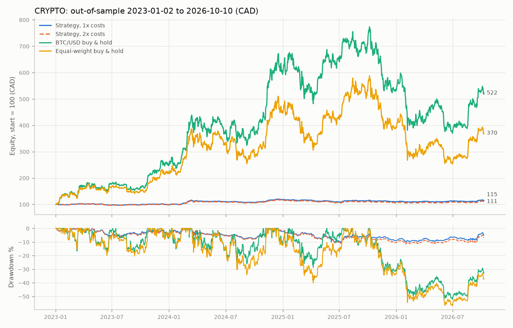

# Backtest: crypto, sentiment off

Period 2021-01-02 to 2026-10-10; out-of-sample (walk-forward) from 2023-01-02. Generated 2026-10-11 17:36 UTC.

## Headline (out-of-sample, 1x costs, vs buy-and-hold over the same window)

- crypto: strategy CAGR +3.7% (Sharpe 0.51, max drawdown -10.4%) vs BTC/USD buy & hold +55.0% (Sharpe 1.17, max drawdown -52.2%): the strategy UNDERperformed.
- crypto: strategy CAGR +3.7% (Sharpe 0.51, max drawdown -10.4%) vs Equal-weight buy & hold +41.5% (Sharpe 0.95, max drawdown -56.9%): the strategy UNDERperformed.

## Assumptions

- Decisions use bars closed at or before the decision time and news available strictly before it; orders fill at the next bar's open plus slippage, only if marketable against the limit (no intrabar fills).
- TSX decides 17:30 Toronto and fills next session's open; crypto decides 00:05 UTC and fills at the open of the UTC day that just began.
- FX: crypto trades in USD; every CAD figure converts USD at the Bank of Canada daily USD/CAD rate of the business day before each valuation (no lookahead). No currency-conversion costs are modelled.
- crypto: Alpaca fee 25 bps (taker) per fill; slippage 15 bps per fill; fills capped at 5% of the bar's volume; limit offsets 25/100 bps (entry/exit). 2x runs double fees and slippage.
- Entries sized at 1% equity risk to a 3x ATR(14) stop, capped per symbol, by the regime/gross cap and by cash; positions are held until the trend exit or the stop (checked on closes).
- Survivorship: the universe is today's large caps, which flatters strategy and benchmarks alike.
- Regime macro-news term is 0 unless archived news covers the date.
- Dropped symbols: SOL/USD (usable history 2.12y < 3y minimum (since 2024-08-27))

## Walk-forward folds (parameters chosen in-sample only)

| asset_class | in_sample | out_of_sample | chosen_params | is_sharpe |
|---|---|---|---|---|
| crypto | 2021-01-02 to 2023-01-02 | 2023-01-02 to 2023-07-02 | fast=50, slow=200, momentum=63 | 0.37 |
| crypto | 2021-07-02 to 2023-07-02 | 2023-07-02 to 2024-01-02 | fast=50, slow=200, momentum=126 | 0.30 |
| crypto | 2022-01-02 to 2024-01-02 | 2024-01-02 to 2024-07-02 | fast=50, slow=200, momentum=126 | 0.29 |
| crypto | 2022-07-02 to 2024-07-02 | 2024-07-02 to 2025-01-02 | fast=50, slow=200, momentum=126 | 0.72 |
| crypto | 2023-01-02 to 2025-01-02 | 2025-01-02 to 2025-07-02 | fast=20, slow=100, momentum=63 | 0.83 |
| crypto | 2023-07-02 to 2025-07-02 | 2025-07-02 to 2026-01-02 | fast=20, slow=100, momentum=63 | 0.79 |
| crypto | 2024-01-02 to 2026-01-02 | 2026-01-02 to 2026-07-02 | fast=50, slow=100, momentum=63 | 0.91 |
| crypto | 2024-07-02 to 2026-07-02 | 2026-07-02 to 2026-10-10 | fast=50, slow=100, momentum=63 | 0.58 |

Sentiment: off for this run (`--sentiment off`).

## Results (CAD; per asset class and combined)

Rows starting with OOS are the honest out-of-sample results. 'Full period ... (in-sample)' rows use the default parameters on the whole period and are shown for reference only.

### crypto

| variant | total_return | cagr | ann_vol | sharpe | sortino | max_drawdown | calmar | win_rate | profit_factor | avg_holding_days | turnover | avg_exposure | trades | cost_drag |
|---|---|---|---|---|---|---|---|---|---|---|---|---|---|---|
| OOS 1x costs | +14.7% | +3.7% | 7.7% | 0.51 | 0.76 | -10.4% | 0.36 | 23.6% | 1.46 | 17.00 | 2.64 | 7.2% | 55 | 1.1% |
| OOS 2x costs | +10.6% | +2.7% | 7.7% | 0.39 | 0.57 | -11.5% | 0.24 | 21.8% | 1.21 | 17.00 | 2.64 | 7.2% | 55 | 2.0% |
| Full period 1x costs, default params (in-sample) | +27.2% | +4.3% | 7.5% | 0.59 | 0.89 | -10.6% | 0.40 | 24.1% | 1.93 | 20.57 | 1.59 | 5.1% | 54 | 0.6% |
| Full period 2x costs, default params (in-sample) | +23.1% | +3.7% | 7.5% | 0.52 | 0.77 | -11.2% | 0.33 | 22.2% | 1.57 | 20.57 | 1.58 | 5.1% | 54 | 1.2% |
| OOS: BTC/USD buy & hold | +422.5% | +55.0% | 46.7% | 1.17 | 1.83 | -52.2% | 1.05 |  |  |  |  |  |  |  |
| OOS: Equal-weight buy & hold | +270.1% | +41.5% | 49.4% | 0.95 | 1.44 | -56.9% | 0.73 |  |  |  |  |  |  |  |
| Full period: BTC/USD buy & hold | +213.8% | +21.9% | 57.5% | 0.63 | 0.93 | -74.9% | 0.29 |  |  |  |  |  |  |  |
| Full period: Equal-weight buy & hold | +247.2% | +24.1% | 67.6% | 0.66 | 0.96 | -76.4% | 0.32 |  |  |  |  |  |  |  |

## Orders

- OOS 1x costs, crypto: 108 filled, 20 partial, 0 expired unfilled, 0 rejected by risk checks
- OOS 2x costs, crypto: 108 filled, 20 partial, 0 expired unfilled, 0 rejected by risk checks

## Files

- 
- trades.csv: every round trip with entry/exit reasons (all variants)
- orders.csv: every order incl. expired and risk-rejected ones
- metrics.json: all metrics above, machine-readable
